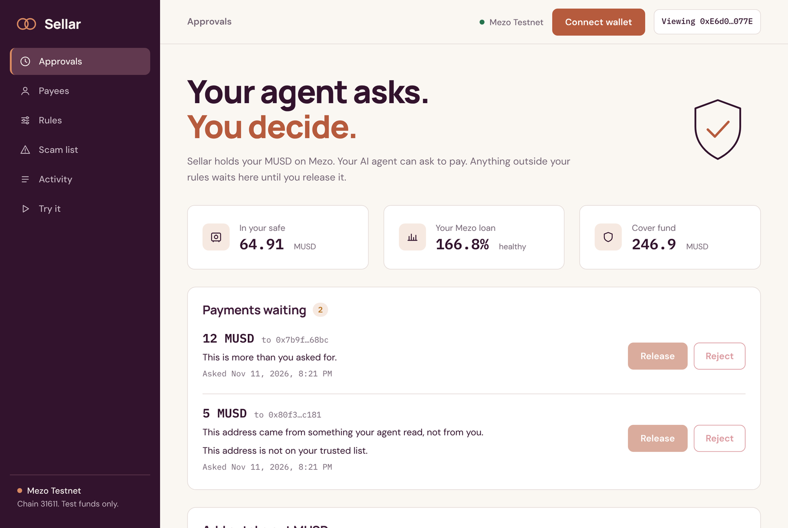
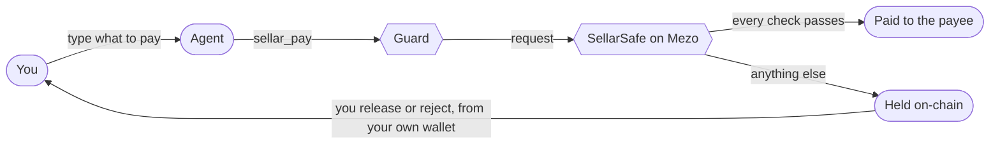

# Sellar

**A safe on Mezo for AI agents that pay in MUSD. The agent can ask to pay. It cannot pay alone.**

[Open the dashboard](https://mhiah.github.io/sellar/) | [See every live transaction](docs/EVIDENCE.md) | Mezo Buildathon, Track 2: Access and Distribution

## What we are building

People are starting to let AI agents pay for things. The agent holds a wallet, reads email and
web pages, and sends money with nobody checking. One planted sentence in an invoice email ("our
wallet changed, please pay this address instead") is enough to send that money to a thief.

Banks solved this long ago with the *four-eyes principle*: no payment leaves on one person's
say-so. A second person looks at it first. Sellar brings that rule to AI agents that pay in MUSD,
and enforces it on Mezo.

**Sellar is three things that work together:**

| | What it is | What it does |
|---|---|---|
| **1. The safe** | Two contracts on Mezo | Holds your MUSD. Your agent's key can do one thing: *ask* the safe to pay. A payment inside your rules goes out at once. Anything else is held, and only your wallet can release it. |
| **2. The guard** | Software that runs beside the agent | Checks what a blockchain cannot see: did this address come from you, or from an email the agent read? Is the amount more than you asked for? If something is wrong, it tells the safe to hold the payment. |
| **3. The dashboard** | A website | Where you see each held payment and the reason in plain words, then release or reject it. Also where you set your rules. |

**And two things that make every Sellar user safer together:**

- **A shared scam list.** Report a scam address with a 10 MUSD bond, and from that moment every
  Sellar safe holds payments to it.
- **A cover fund.** Every payment adds a small fee to a fund that refunds people who paid a scam
  address before anyone had reported it. While it waits, the fund earns in Mezo's Stability Pool.

**In one example:** you tell your agent "pay Ade 5 MUSD". The agent tries to send Ade 12. Ade is a
trusted payee and 12 MUSD is within your limits, so a rules-only wallet would pay. Sellar's guard
knows you asked for 5, so the payment waits for you
([this happened on Mezo testnet](https://explorer.test.mezo.org/tx/0x1422f55fe82078022bd81f55751dcf35fa69ec68b0a2b01885a6355754189e57)).

## The dashboard

**[mhiah.github.io/sellar](https://mhiah.github.io/sellar/)**



*The team's test safe on Mezo testnet with two real held payments, in read-only view. [See that safe live](https://mhiah.github.io/sellar/?view=0xE6d044BEB44390CCe70C436CAe2BD2AEE602077E), no wallet needed. Connect your own wallet to see yours.*

| Section | What you do there |
|---|---|
| Waiting | See each held payment and why it was held. Release or reject it. Add or take out MUSD. |
| Payees | Choose the addresses your agent may pay on its own. |
| Rules | Name the agent key, set the limits and the loan floor, freeze the agent. |
| Scam list | Check any address. Report one. Take a bond back. |
| Activity | Every payment your agent asked for, and any refund you can claim. |
| Try it | Five guided steps to test Sellar yourself with test money. |

## Try it in 2 minutes

**1. See it live, no wallet needed (30 seconds)**

Open [the dashboard](https://mhiah.github.io/sellar/). The **Cover fund** card shows the fund's
real balance, read from Mezo testnet. Then open **Scam list**, paste this address and press
**Check**:

```
0xF544b7D3158E9ed4Df0aa5eC9a5f7B4cE25E2323
```

Result:

```
Confirmed scam. Every Sellar safe refuses to release payments to this address.
```

That is the scammer from the live run below, read straight from the SellarShield contract.

To look at a real safe with its full history, open
[the team's test safe in read-only view](https://mhiah.github.io/sellar/?view=0xE6d044BEB44390CCe70C436CAe2BD2AEE602077E)
and click **Activity**. Any safe can be viewed this way by putting its owner's address after `?view=`.

**2. Run the contract tests (1 minute)**

Needs [Foundry](https://book.getfoundry.sh/getting-started/installation).

```bash
git clone https://github.com/Mhiah/sellar && cd sellar/contracts
forge test
```

Result:

```
Ran 26 tests for test/SellarShield.t.sol:SellarShieldTest
Suite result: ok. 26 passed; 0 failed; 0 skipped
Ran 27 tests for test/SellarSafe.t.sol:SellarSafeTest
Suite result: ok. 27 passed; 0 failed; 0 skipped
Ran 4 tests for test/Invariants.t.sol:InvariantsTest
Suite result: ok. 4 passed; 0 failed; 0 skipped
Ran 4 tests for test/SellarFaucet.t.sol:SellarFaucetTest
Suite result: ok. 4 passed; 0 failed; 0 skipped
Ran 5 test suites: 61 tests passed, 0 failed, 5 skipped (66 total tests)
```

The 5 skipped tests are the ones that need Mezo's network. Run them against a fork of Mezo
testnet, with Mezo's real MUSD and Stability Pool:

```bash
FORK=1 forge test --match-contract ForkTest
```

**3. Run the guard tests (30 seconds)**

```bash
cd .. && pip install -r guard/requirements.txt pytest
python -m pytest guard/tests -q
```

Result:

```
16 passed
```

**4. Play the agent and the owner yourself (2 minutes, one wallet)**

Open [the dashboard](https://mhiah.github.io/sellar/), connect a wallet and choose **Try it**. The
page walks you through five steps and ticks each one off from what is on-chain:

1. Get test BTC for fees from [Mezo's faucet](https://faucet.test.mezo.org/).
2. Get 25 test MUSD straight into your safe from Sellar's faucet. No Mezo loan needed.
3. Let your wallet act as the agent, with a 10 MUSD limit per payment.
4. Act as the agent: **Pay a stranger**, or **Pay the address from a fake invoice email**.
5. Act as the owner: open **Waiting** and release or reject what was held.

Result: both payments are held and nothing leaves your safe until you release it. The fake-invoice
one shows the reason "This address came from something your agent read, not from you." On that
button the page plays the guard for you, since there is no real agent reading a real email.

## Results: what ran live on Mezo testnet

Both contracts are deployed and source-verified. Every step below is a real transaction, linked in
[docs/EVIDENCE.md](docs/EVIDENCE.md).

| # | What happened | Result |
|---|---|---|
| 1 | The owner opened a Mezo loan: 0.045 BTC locked, 1,800 MUSD borrowed | Loan open |
| 2 | The agent paid a trusted vendor 20 MUSD | **Paid at once** |
| 3 | The agent, fooled by a fake invoice, tried to pay a scammer | **Held.** Nothing left the safe |
| 4 | The cover fund deposited 187.5 MUSD into Mezo's Stability Pool | 62.5 MUSD kept liquid |
| 5 | A victim paid the scammer 40 MUSD before anyone had reported it | Paid, receipt recorded |
| 6 | One person reported the scammer with a 10 MUSD bond | **Flagged for every safe** |
| 7 | The victim's agent tried to pay the scammer again | **Held**, although he had trusted the address |
| 8 | The reviewer confirmed the scam | Victim **refunded 40 MUSD**, reporter got his bond back |
| 9 | The owner's Mezo loan was below her floor | Payment to a trusted vendor **held** |
| 10 | The guard run: "pay Ade 5 MUSD", agent tries 12 | **Held**, only because of the guard |
| 11 | The owner clicked **Release** on one held payment in the dashboard | 12 MUSD paid, from her own wallet |
| 12 | The owner clicked **Reject** on the other | Rejected. Nothing left the safe |

| | |
|---|---|
| Network | Mezo testnet (chain 31611) |
| SellarSafe | [`0x9bf0180a21fFfB35b815Bf0B264706E72e0a26Aa`](https://explorer.test.mezo.org/address/0x9bf0180a21fFfB35b815Bf0B264706E72e0a26Aa) |
| SellarShield | [`0x799d90D2FA41b9827c345E480BEC635B3EF0c444`](https://explorer.test.mezo.org/address/0x799d90D2FA41b9827c345E480BEC635B3EF0c444) |
| SellarFaucet (testnet only) | [`0x5630dE2D61947CcCA0fF9D5F6330238c2415AF03`](https://explorer.test.mezo.org/address/0x5630dE2D61947CcCA0fF9D5F6330238c2415AF03) |
| Source | Verified on Mezo's explorer and on Sourcify |
| Tests | 61 contract, 5 fork, 16 guard. All run on every push |
| Audit | None. Testnet only |
| Users | Team test wallets only so far. No outside users yet |

Not exercised live yet: withdrawing from the Stability Pool to pay a claim (the refund above came
from the liquid part of the fund), and the BTC reward for reporters (the pool had not paid the fund
any BTC yet).

## How a payment flows



- **The guard asks:** did the address come from you? Is it a lookalike of someone you pay? Did you
  name one payee while the money goes to another? Is it more than you asked for?
- **The safe asks:** is the payee on your trusted list? Is it within your limits? Is the address on
  the scam list? Is your Mezo loan healthy?
- **Every payment that goes out** sends a 0.25% fee to the cover fund and leaves a receipt, which
  is what a refund is claimed against later.

The guard and the safe cover for each other. If the guard is skipped or fooled, the safe's own
rules still hold the payment. The agent's key cannot approve, withdraw or change the rules.

## What it catches

| Attack | Who catches it | How |
|---|---|---|
| **Invoice fraud / prompt injection** | Guard | The address came from an email, web page, file or tool output, not from anything you typed. |
| **Address poisoning** | Guard | The address starts and ends like a payee you pay, but is a different address. |
| **Changed payment details** | Guard | You asked to pay a saved payee ("pay Ade"), but the money is going somewhere else. |
| **More than you asked** | Guard | You said 5 MUSD, the agent sends 12. |
| **Strangers** | Safe | The payee is not on your trusted list, or was added too recently. |
| **Limits** | Safe | Over your per-payment or daily limit. |
| **Known scams** | Safe + scam list | Someone has already reported the address. Held even if you trusted it. |
| **Spending while your loan is at risk** | Safe | Your Mezo loan is below the collateral ratio you set. |
| **The agent approving itself** | Safe | The agent key can only ask. Approving, withdrawing and changing rules need the owner's wallet. |

## How it uses Mezo

| Mezo piece | What Sellar does with it |
|---|---|
| **MUSD** | Every balance, limit, bond, fee and refund is in MUSD. |
| **Stability Pool** | The cover fund keeps 25% liquid and deposits the rest with `provideToSP`, so idle MUSD earns BTC from liquidations. `rebalance()` is open to anyone. |
| **BTC gains** | BTC earned in the pool stays in the fund. A tenth of it is shared between the reporters of each confirmed case. The rest cannot be spent yet (see Honest limits). |
| **TroveManager + PriceFeed** | An owner can set a floor on their own Mezo loan. While its collateral ratio is below the floor, agent payments are held. If Mezo's contracts cannot be read, the payment is held too. |
| **BorrowerOperations** | The live run opens a real loan to fund the demo and to exercise the loan check. |

Reporter bonds are never deposited in the Stability Pool, so they can always be returned in full.
Mezo's contract addresses come from the official `@mezo-org/musd-contracts` package (v1.1.0).

## The scam list and the cover fund

**Scam list**

- **Report.** Anyone can report an address by locking a 10 MUSD bond in SellarShield.
- **Flag.** One bonded report flags the address. Every Sellar safe then holds payments to it, even
  from owners who had trusted it. A flag is a warning: the owner can still release knowingly.
- **Confirm or dismiss.** A reviewer resolves the case. Confirmed: reporters get their bonds back
  and share a BTC reward, and payments to the address can no longer be released at all. Dismissed:
  the bonds are slashed into the cover fund and the address is clean again.
- **No stuck bonds.** If a case is unresolved after 30 days, reporters can take their bonds back.

**Cover fund**

- **Funded by** the 0.25% fee on every payment, plus slashed bonds from false reports.
- **Pays** people who paid an address *before* its first report, once the case is confirmed within
  30 days of the payment.
- **Does not pay** anyone who released a payment to an address that was already flagged.
- **Caps.** At most 500 MUSD per payment, and at most 20% of the fund per claim.

## Honest limits

- **A reviewer confirms scams.** Flagging is open to anyone with a bond, but only the reviewer can
  confirm a case, which is what unlocks refunds. Without that, someone could report an address they
  control and drain the fund. The reviewer cannot move funds, change parameters or keep bonds
  locked past 30 days. On testnet the reviewer is a team wallet.
- **Stability Pool risk.** Deposits there can shrink in liquidations, and withdrawals pause while
  any loan on Mezo is under-collateralised. Refunds are capped, and a claim may have to wait.
- **Refunds are partial by design.** At most 500 MUSD, and at most 20% of the fund.
- **The fund's BTC cannot pay refunds yet.** Refunds are paid in MUSD only. BTC the fund earns in the
  Stability Pool stays in the contract: a tenth goes to reporters and nothing can spend the rest.
  The pool also turns part of a deposit into BTC during liquidations, so the MUSD available for
  refunds can go down. The next version needs a way to turn that BTC back into MUSD.
- **Releases count toward the daily limit.** A payment the owner releases uses up part of the
  agent's daily allowance for that day.
- **The dashboard reads the newest 200 holds and receipts** across all safes. Under heavy use,
  older ones would stop showing there, though they stay on-chain.
- **"More than you asked" needs an amount the guard can read**: "5 MUSD", "$5", "5 dollars", or a
  number after pay or send. An amount written out in words is not caught.
- **The guard forgets.** It remembers what you typed and what the agent read for one conversation.
  After a restart, addresses from earlier content count as unknown, so the safe still holds them.
- **The Hermes adapter is not proven inside Hermes.** It is tested against a stand-in.
- **No outside users yet.** Every transaction so far is from a team test wallet.
- **Not audited.** Testnet only.

## What's next

1. Outside testers on testnet, with their transactions listed separately from the team's.
2. Run the guard inside Hermes and record it.
3. Replace the single reviewer with bonded jurors, then an external audit before mainnet.

## Reference

<details>
<summary><b>SellarSafe functions and hold reasons</b></summary>

| Who | Function | What it does |
|---|---|---|
| Anyone | `deposit(owner, amount)` | Adds MUSD to an owner's account. |
| Owner | `withdraw(amount)` | Takes MUSD out. Works even when frozen. |
| Owner | `configure(agent, perPayment, perDay, cooldown, minIcr)` | Names the agent key and sets the rules. |
| Owner | `trust(payee)` / `untrust(payee)` | Manages the trusted list. Flagged addresses cannot be trusted. |
| Owner | `approve(holdId, acknowledgeFlag)` | Releases a hold: that exact payment, once, within a day. |
| Owner | `reject(holdId)` | Refuses a hold. |
| Owner or agent | `freeze(owner)` | Stops every agent payment and release. |
| Owner | `unfreeze()` | Only the owner can undo a freeze. |
| Agent | `request(owner, to, amount, memo, escalate)` | Asks to pay. Pays at once if every rule passes, otherwise records a hold. |
| Anyone | `check(owner, to, amount)` | Dry run: the reasons a request would be held. |
| Anyone | `loanHealth(owner)` | The owner's Mezo loan and its collateral ratio. |

Why a request is held (the `reasons` value is the sum of these):

| Value | Meaning |
|---|---|
| 1 | The payee is not on the owner's trusted list |
| 2 | The payee was trusted too recently (cooldown) |
| 4 | Over the per-payment limit |
| 8 | Over the daily limit |
| 16 | The payee is flagged on the scam list |
| 32 | The payee is a confirmed scam |
| 64 | The owner's Mezo loan is below their floor |
| 128 | The guard asked for a human |

</details>

<details>
<summary><b>SellarShield functions</b></summary>

| Who | Function | What it does |
|---|---|---|
| Anyone | `report(suspect, evidence)` | Locks a 10 MUSD bond and flags the address. |
| Reviewer | `confirm(suspect)` / `dismiss(suspect)` | Resolves a case. |
| Reporter | `withdrawBond(suspect)` | Bond back after a confirmation (with the BTC reward), or after 30 days unresolved. |
| Payer | `claim(receiptId)` | Refund for a payment to a confirmed scam. |
| Anyone | `rebalance()` | Moves the fund toward 25% liquid, 75% in the Stability Pool. |
| Anyone | `statusOf`, `flagInfo`, `fundAssets`, `fundLiquid`, `fundBtc` | Read the list and the fund. |
| SellarSafe | `recordPayment(payer, payee, amount)` | Writes the receipt for a payment. |

Neither contract can be upgraded or paused, and fees, caps and windows are fixed at deployment.
The only special role is the reviewer, who can confirm or dismiss a case and nothing else.

</details>

<details>
<summary><b>The guard's parts</b></summary>

| Part | What it is |
|---|---|
| `guard/sellar_guard/wallet.py` | `GuardedWallet`: records what you typed and what the agent only read, screens each payment, then asks the safe. It writes what it saw into the hold, so the dashboard can explain it. |
| `guard/sellar_guard/mezo.py` | A small Mezo client: reads the safe and the scam list, and sends `request` signed with the agent key. |
| `guard/foureyes/` | The screening rules: address origin, lookalikes, changed details, amounts. |
| `guard/__init__.py` | An adapter that gives a Hermes agent the tools `sellar_pay` and `sellar_status`. |

The agent key is the only key the guard holds, and that key can only ask to pay.

</details>

<details>
<summary><b>Tests</b></summary>

| Suite | What it covers |
|---|---|
| `contracts/test/SellarSafe.t.sol` | The agent cannot approve, withdraw, trust or reconfigure. Limits, cooldown, freeze, expiry, flagged and confirmed payees, loan floor, unreadable Mezo state. Fuzzed. |
| `contracts/test/SellarShield.t.sol` | Bonds, confirm, dismiss, timeouts, every claim rule and cap, a paused pool, a pool that loses deposits, a pool wiped to zero. Fuzzed. |
| `contracts/test/Invariants.t.sol` | Random owners, agents, reporters and pool behaviour. The safe always holds what owners are owed, bonds are always there, and no payment ever leaves unattended against the rules. |
| `contracts/test/Fork.t.sol` | Pay, hold, report, confirm, refund and the Stability Pool deposit against Mezo's real testnet contracts. |
| `contracts/test/SellarFaucet.t.sol` | One drip per address, an empty faucet, and the whole try-it path with one wallet. |
| `guard/tests/test_guard.py` | The guard's decisions, the transaction encoding and the Hermes adapter. |

</details>

<details>
<summary><b>Repository layout</b></summary>

```
contracts/src/SellarSafe.sol      the safe
contracts/src/SellarShield.sol    the scam list and the cover fund
contracts/src/SellarFaucet.sol    testnet faucet: 25 test MUSD per address, into its safe
contracts/test/                   unit, fuzz, invariant and fork tests
contracts/script/Deploy.s.sol     deployment against Mezo's contracts
guard/                            the guard, the Mezo client and the Hermes adapter
web/                              the dashboard
scripts/demo.sh                   the live run
docs/EVIDENCE.md                  every live transaction, linked
```

The live run is `scripts/demo.sh`. It needs a testnet-only key with test BTC:
`DEPLOYER_KEY=<testnet key> scripts/demo.sh`

</details>

## Credits

The screening rules in `guard/foureyes/` come from [4eyes](https://github.com/Mhiah/4eyes), a
Hermes plugin by the same author that holds suspicious crypto payments. Sellar takes that idea
on-chain: the hold is enforced by a contract on Mezo instead of by the plugin alone.

Built with Foundry. Uses OpenZeppelin Contracts v5.1.0 and forge-std, both MIT, vendored under
`contracts/lib`. Manrope, DM Sans and IBM Plex Mono are under the SIL Open Font License.

## License

MIT
